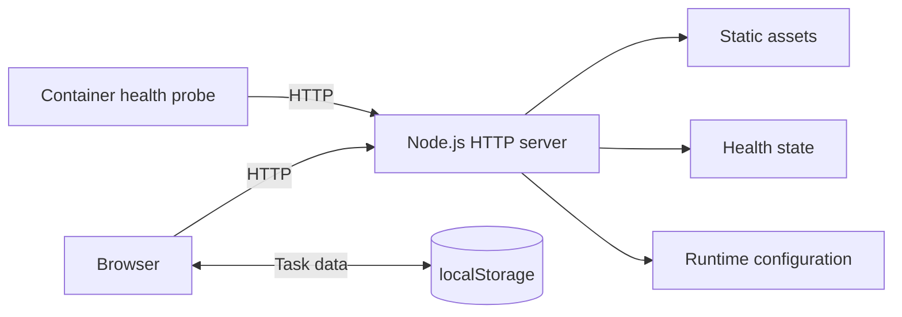

# Application architecture

## Components

| Component | Responsibility |
| --- | --- |
| `src/main.mjs` | Process startup, HTTP listener and graceful shutdown |
| `src/config.mjs` | Environment variable parsing and validation |
| `src/http-server.mjs` | HTTP routes, static assets, health and release metadata |
| `src/health.mjs` | Independent health state evaluation |
| `public/board-model.mjs` | Task operations and stored data validation |
| `public/app.mjs` | Browser rendering, events and local persistence |
| `scripts/docker-healthcheck.mjs` | Container-local HTTP readiness check |

## Runtime boundaries

The application listens on port 8080 by default. Browser clients receive static assets and query release metadata and readiness over HTTP. Task data remains in browser storage. The server does not expose task mutation APIs or store user data. Authentication and shared persistence are outside the current application scope.

Health state is evaluated per process using elapsed time. Fault injection is disabled by default and controlled only by process environment variables. There is no HTTP endpoint for triggering failures. Health endpoints do not expose credentials or internal configuration values.

The container runs as a non-root user. HTTP responses include a Content Security Policy, `X-Content-Type-Options` and `Referrer-Policy`. Production transport security and access control are responsibilities of the deployment environment.
